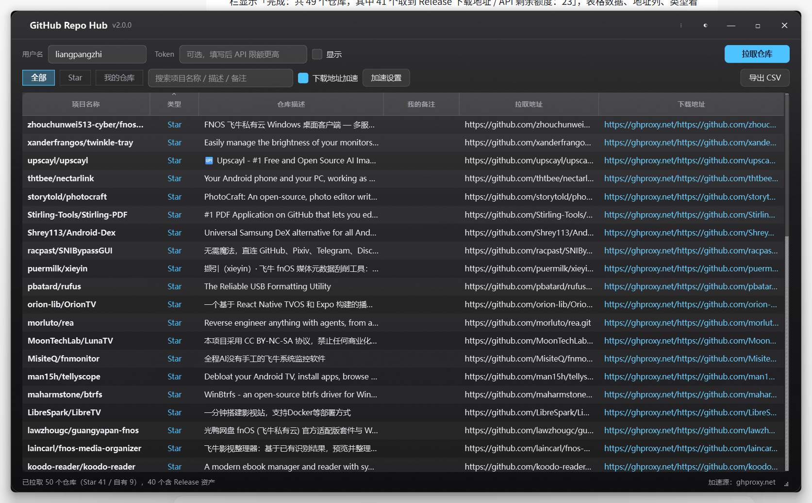
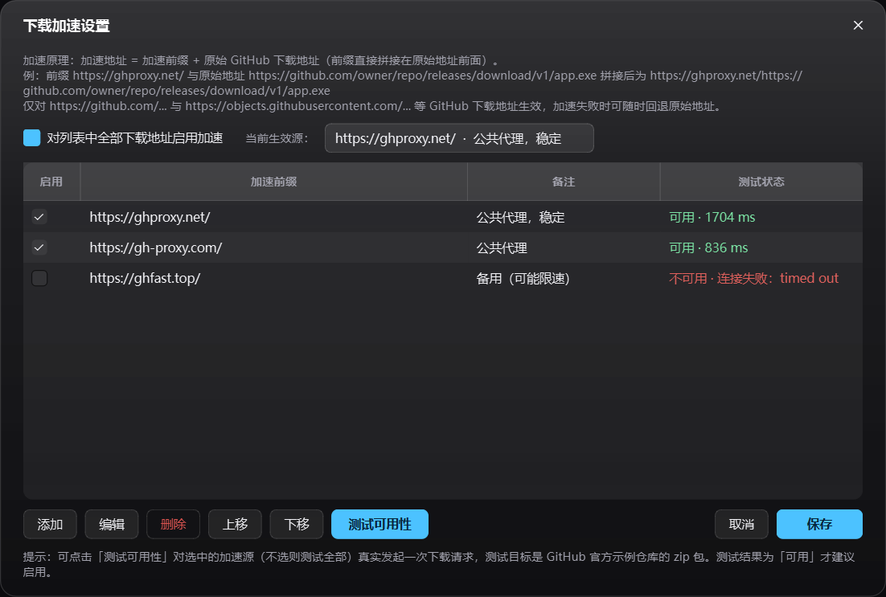

# GitHub Repo Hub · GitHub 项目管家

一个 Windows 桌面小工具：**一键拉取你 Star 过的项目和自己的仓库**，按项目名称排序，显示仓库描述、自定义备注、`git clone` 拉取地址与可直接下载的安装包地址。界面为 **Windows 11 毛玻璃（亚克力模糊）+ 圆角无边框**风格，内置**可自定义的 GitHub 下载加速地址**。

> 单文件 exe，双击即用，无需安装 Python 或任何运行库。



## 功能

- **一键拉取两类数据**：自己 Star 的仓库、自己拥有的仓库（支持分页，全部拉取）
- **多种排序与筛选**：点击任意表头切换升序/降序；按类型（全部 / Star / 我的仓库）筛选；关键词搜索项目名、描述、备注
- **备注持久化**：双击「我的备注」列即可编辑，保存在本机配置中，下次启动自动恢复
- **下载地址自动解析**：优先取仓库最新 Release 的资产直链（自动挑选 `.exe/.msi/.zip/.7z/.tar.gz/.dmg/.deb/.apk` 中最合适的一个），无 Release 时回退默认分支 zip 归档地址
- **下载加速**：可添加、编辑、启用多个加速前缀（如 `https://ghproxy.net/`、`https://gh-proxy.com/`），支持真实请求的「测试可用性」，列表直接显示加速后地址，右键可分别复制/打开加速地址或原始地址，加速失败自动回退原始地址
- **Windows 11 视觉**：DWM 毛玻璃半透明 + 圆角 + 无系统粗边框 + 自定义标题栏；深色/浅色/跟随系统三种外观
- **CSV 导出**：当前筛选结果导出为 UTF-8 BOM 表格，Excel 直接打开
- **友好异常处理**：断网、用户不存在（404）、Token 失效（401）、API 限流（403/429）均给出中文提示，程序不崩溃



## 下载

程序体积约 45 MB（内含 PySide6 运行时），请到 **Releases** 页面下载最新版单文件 exe：

- [GitHubRepoHub v2.0.0](https://github.com/liangpangzhi/GitHubRepoHub/releases/latest)

源码仓库不含 exe，避免仓库体积膨胀。

## 快速上手

1. 双击 `GitHubRepoHub.exe`（首次启动需自解压，可能需要几秒到十几秒）
2. 填写 GitHub 用户名（已预填 `liangpangzhi`，可修改）
3. 需要读取私有仓库或提高 API 限额时，填入 Personal Access Token（`repo` 或 `public_repo` 权限即可）
4. 点击「拉取仓库」或按 <kbd>F5</kbd>

### 快捷键

| 快捷键 | 功能 |
|---|---|
| <kbd>F5</kbd> | 一键拉取 |
| <kbd>Ctrl</kbd>+<kbd>F</kbd> | 聚焦搜索框 |
| <kbd>Ctrl</kbd>+<kbd>C</kbd> | 复制选中行的拉取地址 |
| 双击标题栏 | 最大化 / 还原 |

## 下载加速说明

加速地址 = **加速前缀 + 原始 GitHub 地址**（前缀直接拼接，不做改写）：

```
https://ghproxy.net/ + https://github.com/owner/repo/releases/download/v1/app.exe
→ https://ghproxy.net/https://github.com/owner/repo/releases/download/v1/app.exe
```

- 仅对 `github.com` / `objects.githubusercontent.com` 等 GitHub 下载地址生效
- 「测试可用性」会真实请求前 512 字节并校验 zip 头或 `application/zip` 类型，返回耗时与失败原因
- 配置写入 `%USERPROFILE%\.github_repo_hub\config.json` 的 `accelerators` / `accel_global` / `accel_active` 字段

详细说明见 [使用说明.md](使用说明.md)。

## 配置文件

- 路径：`%USERPROFILE%\.github_repo_hub\config.json`
- 字段：`username`、`token`、`show_token`、`notes`（按 `owner/repo` 存储）、`sort_col`、`sort_desc`、`geometry`、`theme`、`accelerators`、`accel_global`、`accel_active`
- 删除该文件即恢复出厂状态；Token 以明文保存在本机，共用电脑请注意

## 从源码运行 / 打包

环境：Windows 10/11 x64，Python 3.11+

```powershell
pip install PySide6 pyinstaller
python github_repo_hub.py          # 直接运行源码

# 打包为单文件 exe（路径建议全用绝对路径，避免 PyInstaller CopyIcons 相对路径报错）
python -m PyInstaller --noconfirm --onefile --windowed --name GitHubRepoHub `
  --icon app.ico --exclude-module tkinter `
  --exclude-module PySide6.QtWebEngineCore --exclude-module PySide6.QtWebEngineWidgets `
  --exclude-module PySide6.QtQml --exclude-module PySide6.QtQuick `
  --exclude-module PySide6.QtMultimedia github_repo_hub.py
```

或直接执行 `build.ps1`，产物在 `dist\GitHubRepoHub.exe`。

## 技术要点

- 界面：PySide6 6.12 + QSS 统一主题；毛玻璃通过 ctypes 调用 `SetWindowCompositionAttribute`（`ACCENT_ENABLE_BLURBEHIND`）+ `DwmExtendFrameIntoClientArea`，圆角通过 `DWMWA_WINDOW_CORNER_PREFERENCE`
- 网络：仅用标准库 `urllib.request` 调用 GitHub REST API，不依赖第三方 HTTP 库
- 兼容性：Win10 或系统关闭透明效果时自动退化为不透明纯色背景，功能不受影响

## 已知限制

- 毛玻璃/圆角依赖 Windows 11 DWM，旧系统为纯色背景
- 加速效果取决于第三方代理服务本身，代理失效时请重新测试并更换前缀
- 匿名调用 GitHub API 限额 60 次/小时，仓库较多时建议填 Token（5000 次/小时）
- 单文件 exe 每次启动需自解压，冷启动略慢

## License

MIT

*（内容由 AI 生成，仅供参考）*
